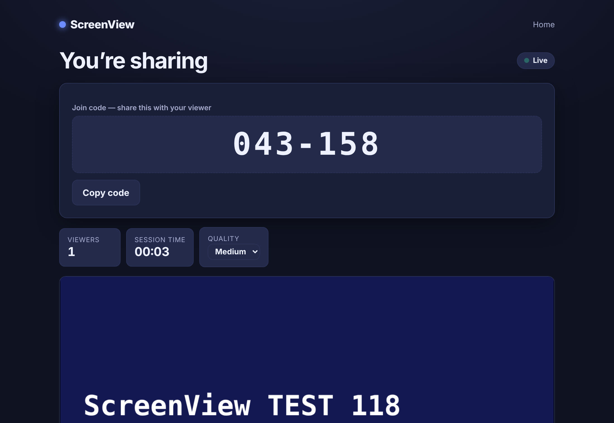
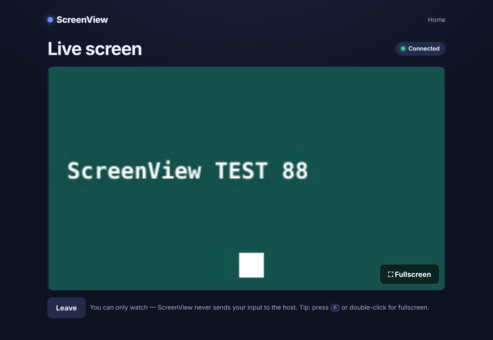

# ScreenView

View-only live screen sharing in the browser, joined with a 6-digit code.

A **host** clicks *Start sharing*, picks a screen, and gets a code like
`482-913`. A **viewer** types the code and watches the host's screen live.
The viewer can never control the host: there is no control channel at all.
Nothing to install for either person.

**Live:** <https://screenview-share.vercel.app> (hosted on Vercel; see
[Deploying to Vercel](#deploying-to-vercel)).




## Features

- 6-digit join codes from `crypto.randomInt`; unused codes expire after 10 min,
  ended codes never work again
- Peer-to-peer WebRTC video; the server only relays signaling
- View-only by design: viewer is `recvonly`, no data channel (tested)
- Built for long sessions: automatic ICE restart, signaling that quietly retries
  and re-admits a dropped viewer automatically (no re-entering the code),
  60 s grace period for the host
- Runs on a laptop (`npm start`) **or** on Vercel's serverless platform, from the
  same code
- Host dashboard: code, viewer count, session timer, live quality switch, End
  session; the browser's own "Stop sharing" button also ends the session
- Viewer: auto-formatted code box, clear error messages, fullscreen,
  connection badge, reconnecting overlay
- Optional session password, brute-force rate limiting, Low/Medium/High quality
- Session log (`logs/sessions.jsonl` locally, the database on Vercel) and a
  password-protected `/admin` page
- **Installable as an app** (Chrome/Edge "Install app" button): opens in its own
  window with its own icon, no app store or installer needed
- One-click **invite link** for the viewer that uses the host's network address
  and opens with the code already filled in
- Notifications when a viewer joins or leaves; **F** or double-click for fullscreen

## Quick start

Requires Node.js 22 LTS or newer.

```bash
git clone https://github.com/eddienjeru564-ship-it/screen-mirroring-app.git
```

```bash
cd screen-mirroring-app
```

```bash
npm install
```

```bash
npm start
```

**Simplest setup (same network):** run `npm start` on the **host's** laptop.

- The host opens <http://localhost:3000> and clicks *Start sharing*.
- The viewer opens `http://<host-laptop-IP>:3000` (e.g. `http://192.168.1.20:3000`)
  and enters the code.

> Browsers only allow screen *capture* on `localhost` or over **HTTPS**, which
> is why the host uses `localhost`. Watching works over plain HTTP. To run the
> server somewhere else (a school server, the cloud), put it behind HTTPS, e.g.
> with a reverse proxy such as Caddy, or use Vercel (below), which is HTTPS
> already. Configure TURN for viewers on very restrictive networks.

## Deploying to Vercel

The repository deploys to Vercel as-is: `vercel.json` serves `public/` from
Vercel's CDN and runs the API (`api/index.js`) as a serverless function.

Vercel may run each request on a different server instance, so live sessions
cannot be kept in memory there. ScreenView keeps them in a shared database
instead, either **Supabase** (what the live site uses) or **Upstash Redis**.
Both free plans are plenty.

1. Import the GitHub repository in Vercel (Framework preset: **Other**).
2. Connect a store, **one** of:
   - **Supabase:** in a Supabase project, run
     `supabase/migrations/0001_screenview_store.sql` (SQL editor or
     `supabase db push`), then store a long random secret:
     `insert into screenview_config (k, v) values ('secret', '<random>');`.
     In Vercel set `SUPABASE_URL`, `SUPABASE_PUBLISHABLE_KEY` (the project's
     publishable or anon key) and `SCREENVIEW_STORE_SECRET` (the same random
     value, type *Sensitive*).
   - **Upstash Redis:** in the Vercel project, open **Storage → Create Database
     → Upstash for Redis**, pick the Free plan and connect it. This sets
     `KV_REST_API_URL` and `KV_REST_API_TOKEN` for you.
3. Optionally set `ADMIN_PASSWORD` under **Settings → Environment Variables**.
4. Redeploy. <code>https://&lt;your-project&gt;.vercel.app/api/health</code> should say
   `"storageConfigured": true`.

Without step 2 the site still loads, but starting a session shows a clear
"session storage is missing" message instead of failing randomly.

Each active session makes roughly 1–2 small store requests per second while
idle (more while a connection is being set up). The free tiers cover demos and
testing; long all-day use may need a paid plan.

## Configuration

All settings are optional environment variables (see `.env.example`).

| Variable | Default | Meaning |
|---|---|---|
| `PORT` | `3000` | HTTP port |
| `ADMIN_PASSWORD` | *(unset)* | Enables `/admin`; disabled when unset |
| `CODE_EXPIRY_MS` | `600000` | Lifetime of an unused code (10 min) |
| `GRACE_MS` | `60000` | How long a session survives a host disconnect |
| `VIEWER_STALE_MS` | `12000` | A viewer silent this long counts as gone (it is re-admitted automatically when it returns) |
| `SUPABASE_URL`, `SUPABASE_PUBLISHABLE_KEY`, `SCREENVIEW_STORE_SECRET` | *(unset)* | Supabase store (all three needed). On Vercel a store is required: Supabase or Upstash |
| `KV_REST_API_URL`, `KV_REST_API_TOKEN` | *(unset)* | Upstash Redis store. Optional locally (memory is used without a store) |
| `MAX_VIEWERS` | `1` | Viewers per session (1–3) |
| `RATE_LIMIT_MAX` | `5` | Failed join attempts allowed per IP… |
| `RATE_LIMIT_WINDOW_MS` | `60000` | …per this window |
| `TURN_URL`, `TURN_USERNAME`, `TURN_CREDENTIAL` | *(unset)* | Optional TURN server; STUN-only without it |
| `LOG_FILE` | `logs/sessions.jsonl` | Session log location (local only; on Vercel the log is kept in the store) |

Example:

```bash
ADMIN_PASSWORD=s3cret MAX_VIEWERS=3 npm start
```

## Tests

```bash
npm test
```

```bash
npx playwright install chromium
```

```bash
npm run test:e2e
```

```bash
SOAK_MINUTES=120 npm run test:soak
```

24 unit tests and 17 end-to-end tests; a 120-minute soak run is recorded in
[docs/TESTING.md](docs/TESTING.md). `npm run screenshots` regenerates the
images in `docs/img/`; `npm run icons` regenerates the app icons.

## Project layout

```
server/   app.js (the HTTP API), index.js (local server), sessions.js,
          store.js (memory / Upstash Redis / Supabase), rateLimit.js, logger.js
api/      index.js (Vercel function entry; vercel.json routes /api/* to it)
public/   index/host/view/admin pages, rtc.js (shared WebRTC helpers),
          signal.js (HTTPS signaling client), app.js
          (install + toasts), sw.js (service worker), manifest.webmanifest, icons/
tests/    unit/ (node --test), e2e/ (Playwright, incl. soak.spec.js)
docs/     ARCHITECTURE, SECURITY, TESTING, USER_GUIDE, img/
scripts/  screenshots.js, icons.js
```

## Documentation

- [User guide](docs/USER_GUIDE.md): step-by-step for hosts and viewers
- [Architecture](docs/ARCHITECTURE.md): components, sequence and reconnect diagrams
- [Security](docs/SECURITY.md): why view-only is guaranteed, codes, rate limiting, logging, limitations
- [Testing](docs/TESTING.md): strategy, headless WebRTC, soak results
- [DECISIONS.md](DECISIONS.md): design decisions made during the build
