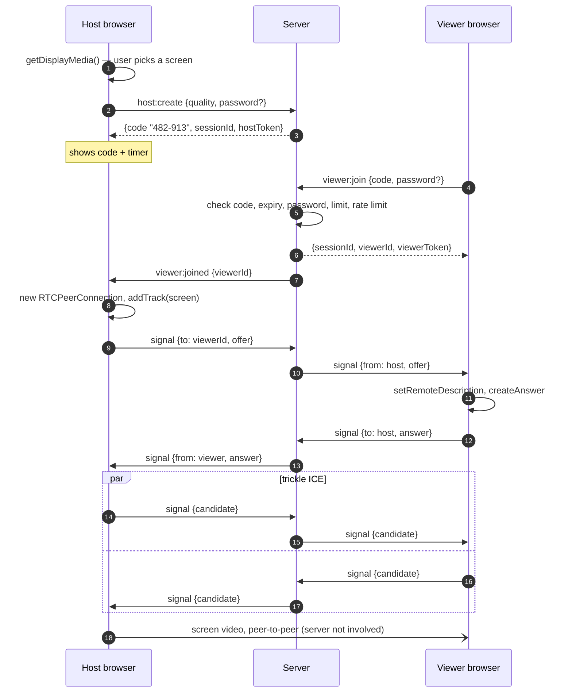
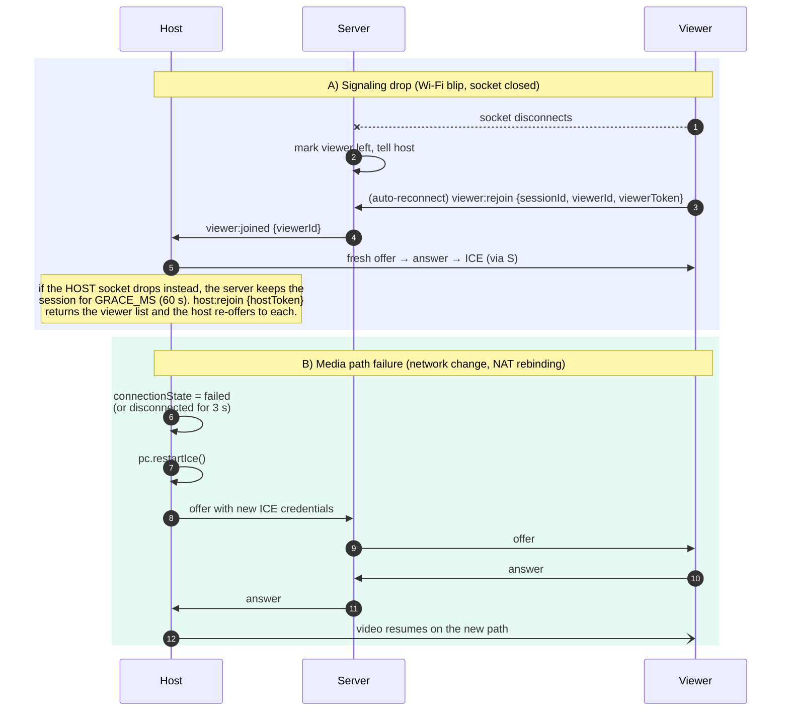

# Architecture

ScreenView has three parts: a **host page**, a **viewer page**, and one **Node
server**. The server serves the pages and relays signaling messages. Video never
passes through the server: once connected, it flows directly between the two
browsers over WebRTC.

```
 Host browser                    Node server                     Viewer browser
┌──────────────┐  Socket.io   ┌─────────────────────┐  Socket.io  ┌──────────────┐
│ host.js      │◄────────────►│ index.js (relay)    │◄───────────►│ view.js      │
│ getDisplay-  │  signaling   │ sessions.js (codes) │  signaling  │ recvonly     │
│ Media()      │              │ rateLimit.js        │             │ <video>      │
│ RTCPeerConn. │              │ logger.js → .jsonl  │             │ RTCPeerConn. │
└──────┬───────┘              └─────────────────────┘             └──────▲───────┘
       │                 screen video, peer-to-peer (WebRTC/SRTP)        │
       └─────────────────────────────────────────────────────────────────┘
```

## Components

| File | Role |
|---|---|
| `server/index.js` | Express app (static files, `/api/ice-config`, `/api/admin/sessions`) and the Socket.io signaling relay. Handles disconnects, the grace period, and the periodic sweep. |
| `server/sessions.js` | Pure session logic: code generation (`crypto.randomInt`), expiry, viewer limit, passwords, rejoin tokens. No I/O, so it is unit-tested directly. |
| `server/rateLimit.js` | Sliding-window limiter on failed join attempts per IP. |
| `server/logger.js` | Append-only JSON-lines audit log, plus folding it into per-session rows for `/admin`. |
| `public/rtc.js` | Shared WebRTC helpers: ICE config fetch, quality presets, connection-health monitor. |
| `public/host.js` | Captures the screen, creates the session, keeps one `RTCPeerConnection` per viewer, performs ICE restarts. |
| `public/view.js` | Code entry, answer-only peer connection, status/reconnect UI, fullscreen. |
| `public/admin.js` | Password-protected session table. |

## Key design choices

- **Host is the only offerer.** The viewer adds no tracks and no data channel,
  so negotiation only ever goes host → offer, viewer → answer. Two sides can
  never offer at the same time ("glare"), which keeps the code simple.
- **One peer connection per viewer.** Fine for up to 3 viewers. A larger
  audience would need a media server (SFU); see SECURITY.md → limitations.
- **Stable identities across reconnects.** Socket.io gives a new socket id on
  every reconnect. The server therefore hands the host a `hostToken` and each
  viewer a `viewerId` + `viewerToken`; signaling is addressed by these, not by
  socket id.
- **In-memory sessions.** No database is needed for live sessions. The
  `.jsonl` log is the durable record.

## Connection flow



## Reconnect flows

Two different things can break during a long session, and each has its own
recovery path. Neither one asks the viewer for the code again.



If the host does not come back within the grace period, the sweep ends the
session with reason `host_timeout` and every viewer sees "Host disconnected".

## Session lifecycle

```
            host:create                first viewer joins
  (none) ─────────────► waiting ─────────────────────────► live
                           │                                 │
       CODE_EXPIRY_MS ─────┤                                 ├── host:end / Stop sharing
       passes (sweep)      ▼                                 ├── host gone > GRACE_MS
                         ended ◄─────────────────────────────┘
                 (code removed; never joinable again)
```

## Signaling messages

| Event | Direction | Payload |
|---|---|---|
| `host:create` | H → S | `{quality, password?}` → ack `{code, codePretty, sessionId, hostToken}` |
| `host:rejoin` | H → S | `{sessionId, hostToken}` → ack `{viewers: [viewerId]}` |
| `viewer:join` | V → S | `{code, password?}` → ack `{sessionId, viewerId, viewerToken}` or `{error}` |
| `viewer:rejoin` | V → S | `{sessionId, viewerId, viewerToken}` |
| `viewer:joined` / `viewer:left` | S → H | `{viewerId}` |
| `signal` | both | `{to, data: {description} | {candidate}}`, relayed as `{from, data}` |
| `host:quality` | H → S | `{quality}` |
| `host:end` | H → S | — |
| `session:viewers` | S → room | `{count, max}` |
| `session:ended` | S → room | `{reason}` |
