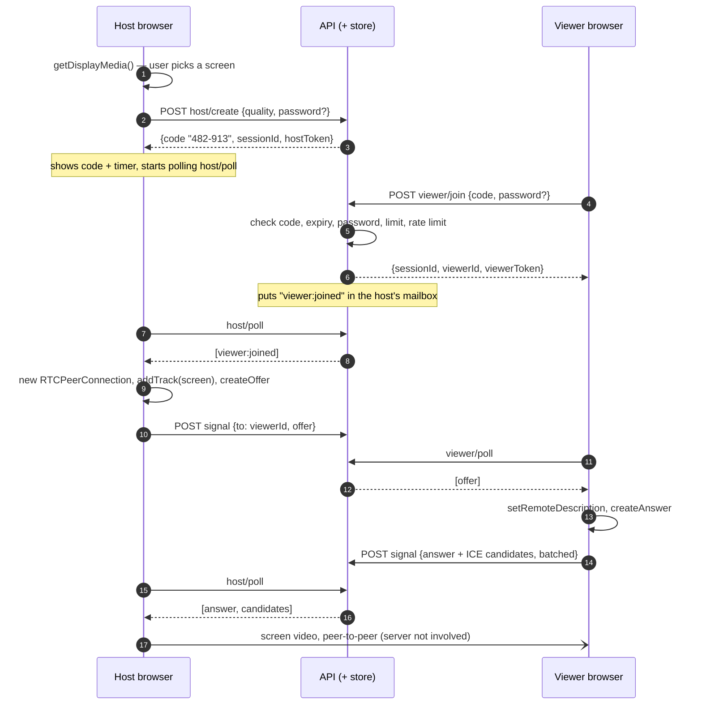

# Architecture

ScreenView has three parts: a **host page**, a **viewer page**, and a small
**HTTP API**. The API relays signaling messages and keeps track of sessions.
Video never passes through the server: once connected, it flows directly
between the two browsers over WebRTC.

The same code runs in two places:

- **On a laptop** (`npm start`): one Node process serves the pages and the API,
  and keeps sessions in memory.
- **On Vercel**: the pages come from Vercel's CDN and the API runs as a
  serverless function (`api/index.js`). Each request may land on a different
  function instance, so sessions are kept in a shared database (**Supabase** on the live site, or **Upstash Redis**), not in memory.

```
 Host browser                  ScreenView API                   Viewer browser
┌──────────────┐  HTTPS       ┌──────────────────────┐  HTTPS   ┌──────────────┐
│ host.js      │─ POST/poll ─►│ app.js (routes)      │◄─ POST/ ─│ view.js      │
│ getDisplay-  │◄─ replies ───│ sessions.js (logic)  │── poll ─►│ recvonly     │
│ Media()      │              │ store.js ─► memory   │          │ <video>      │
│ RTCPeerConn. │              │          └► Redis    │          │ RTCPeerConn. │
└──────┬───────┘              └──────────────────────┘          └──────▲───────┘
       │                 screen video, peer-to-peer (WebRTC/SRTP)        │
       └─────────────────────────────────────────────────────────────────┘
```

## Components

| File | Role |
|---|---|
| `server/app.js` | The HTTP API (Express): create/poll/end for hosts, join/poll/leave for viewers, the signaling relay, ICE config, admin. Used by both the local server and Vercel. |
| `server/index.js` | Local server: the API plus the static pages, one `npm start`. |
| `api/index.js` + `vercel.json` | Vercel entry point. `vercel.json` routes `/api/*` to the function and serves `public/` from the CDN. |
| `server/sessions.js` | All session logic: code generation (`crypto.randomInt`), expiry, viewer limit, passwords, presence, mailboxes. Stateless: everything is read from and written to the store on each request. |
| `server/store.js` | The store: `MemoryStore` (local), `UpstashStore` (Redis over Upstash's REST API) or `SupabaseStore` (Postgres: the `screenview_exec` function in `supabase/migrations/`, called over Supabase's REST API). Same small API, chosen from environment variables. |
| `server/rateLimit.js` | Failed join attempts per IP, kept in the store. |
| `server/logger.js` | Append-only audit log: a JSON-lines file locally, a capped list in the store on Vercel; folded into per-session rows for `/admin`. |
| `public/signal.js` | Browser side of signaling: JSON POSTs, a poll loop (300 ms while connecting, ~2 s when idle), batching of ICE candidates, quiet retries. |
| `public/rtc.js` | Shared WebRTC helpers: ICE config fetch, quality presets, connection-health monitor. |
| `public/host.js` | Captures the screen, creates the session, keeps one `RTCPeerConnection` per viewer, performs ICE restarts. |
| `public/view.js` | Code entry, answer-only peer connection, status/reconnect UI, fullscreen. |
| `public/admin.js` | Password-protected session table. |
| `public/app.js` | Loaded on every page: registers the service worker, shows the "Install app" button, provides toast notifications. |
| `public/sw.js` + `manifest.webmanifest` | Make ScreenView installable as an app. Network-first caching of the static shell only; never touches `/api`. |

## Key design choices

- **Host is the only offerer.** The viewer adds no tracks and no data channel,
  so negotiation only ever goes host → offer, viewer → answer. Two sides can
  never offer at the same time ("glare"), which keeps the code simple.
- **One peer connection per viewer.** Fine for up to 3 viewers. A larger
  audience would need a media server (SFU); see SECURITY.md → limitations.
- **Signaling over plain HTTPS with polling, not WebSockets.** Serverless
  functions cannot hold a connection open for a 2-hour session, and two
  WebSocket clients may be connected to different instances that cannot talk
  to each other. Short, independent requests work on any instance. Each
  participant has a **mailbox** (a Redis list); sending a message appends to
  the recipient's mailbox, and each poll empties the caller's mailbox
  atomically. Polling is fast (300 ms) while a connection is being set up, so
  joining still takes only a second or two, and slow (~2 s) once video flows,
  because WebRTC then needs no further signaling.
- **Presence by heartbeat.** Every poll doubles as a heartbeat. A viewer silent
  for `VIEWER_STALE_MS` (12 s) is counted as gone; a host silent for `GRACE_MS`
  (60 s) ends the session. A viewer pressing *Leave* or closing the tab tells
  the server straight away (`sendBeacon`).
- **No timers on the server.** Serverless functions only run while answering a
  request, so time-based rules (code expiry, host timeout) are checked lazily
  whenever a request touches the session. Every key in Redis has its own
  expiry, so nothing needs a cleanup job.
- **Tokens, not connections, identify people.** The host gets a `hostToken` and
  each viewer a `viewerId` + `viewerToken`; every request carries them. A
  viewer that comes back after a network drop is recognised by its token and
  re-admitted without the code.
- **One store interface, two backends.** The in-memory store keeps `npm start`
  zero-config; Upstash Redis makes Vercel work. Unit tests run every session
  rule against both (Upstash via a fake REST API), and an e2e suite runs the
  whole app in "Vercel mode" over Redis REST calls.

## Connection flow



## Reconnect flows

Two different things can break during a long session, and each has its own
recovery path. Neither one asks the viewer for the code again.

```mermaid
sequenceDiagram
    autonumber
    participant H as Host
    participant S as API
    participant V as Viewer

    rect rgba(108,140,255,0.12)
    Note over H,V: A) Signaling drop (Wi-Fi blip, server unreachable)
    V--xS: polls fail; retried quietly with back-off
    Note over V: video keeps playing: it is peer-to-peer
    S->>S: viewer silent > VIEWER_STALE_MS → marked gone, host told
    V->>S: viewer/poll (token) once the network is back
    S-->>V: {rejoined: true}
    S->>H: viewer:joined (rejoin)
    H->>V: fresh offer → answer → ICE (via S)
    Note over H: if the HOST drops instead, the session waits GRACE_MS (60 s)<br/>for its next poll; the P2P video is unaffected meanwhile
    end

    rect rgba(55,211,153,0.12)
    Note over H,V: B) Media path failure (network change, NAT rebinding)
    H->>H: connectionState = failed<br/>(or disconnected for 3 s)
    H->>H: pc.restartIce()
    H->>S: offer with new ICE credentials
    S->>V: offer
    V->>S: answer
    S->>H: answer
    H-)V: video resumes on the new path
    end
```

If the host does not poll again within the grace period, the next request
that touches the session ends it with reason `host_timeout`, and every viewer
sees "Host disconnected".

## Session lifecycle

```
            host/create               first viewer joins
  (none) ─────────────► waiting ─────────────────────────► live
                           │                                 │
       CODE_EXPIRY_MS ─────┤                                 ├── End session / Stop sharing
       passes              ▼                                 ├── host silent > GRACE_MS
                         ended ◄─────────────────────────────┘
                 (code removed; never joinable again)
```

## API

All signaling endpoints are `POST` with a JSON body and always answer `200`
with `{ok, ...}`; application errors are values (`{ok: false, error}`), not
HTTP errors, so the browser console stays clean.

| Endpoint | Caller | Body → reply |
|---|---|---|
| `host/create` | host | `{quality, password?}` → `{code, codePretty, sessionId, hostToken}` |
| `host/poll` | host | `{sessionId, hostToken}` → `{events, viewers, max, pollMs}` or `{ended}` |
| `host/quality` | host | `{…auth, quality}` |
| `host/end` | host | `{…auth, reason}` |
| `viewer/join` | viewer | `{code, password?}` → `{sessionId, viewerId, viewerToken}` or `{error}` |
| `viewer/poll` | viewer | `{sessionId, viewerId, viewerToken}` → `{events, rejoined, quality, pollMs}` or `{ended}` |
| `viewer/leave` | viewer | `{…auth}` (also sent with `sendBeacon` when the tab closes) |
| `signal` | both | `{role, …auth, messages: [{to, data: {description} \| {candidate}}]}` |
| `GET ice-config`, `GET health`, `GET info`, `GET admin/sessions` | pages | STUN/TURN list; health incl. store type; LAN URLs (local only); admin table |

Mailbox events: `viewer:joined {viewerId, rejoin?}`, `viewer:left {viewerId}`,
`signal {from, data}`.
