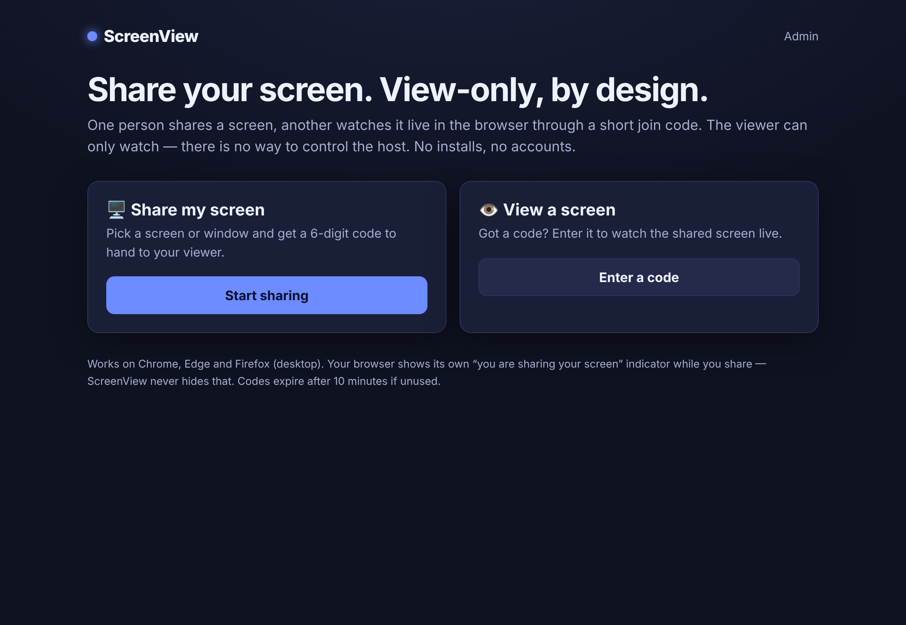
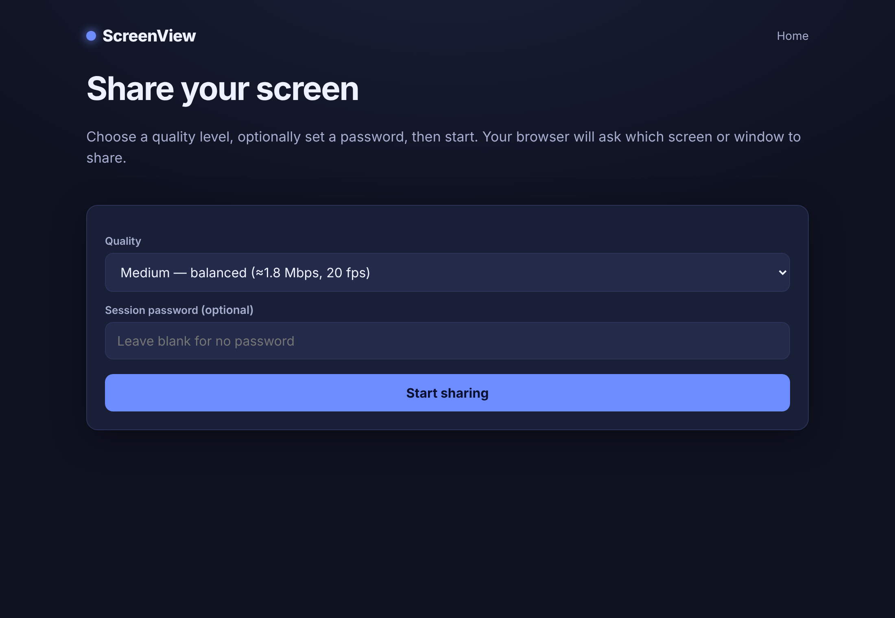
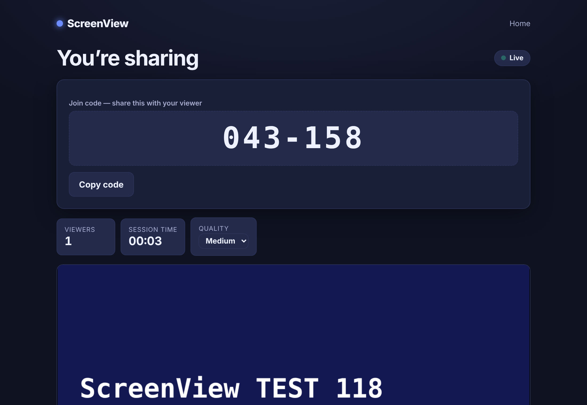
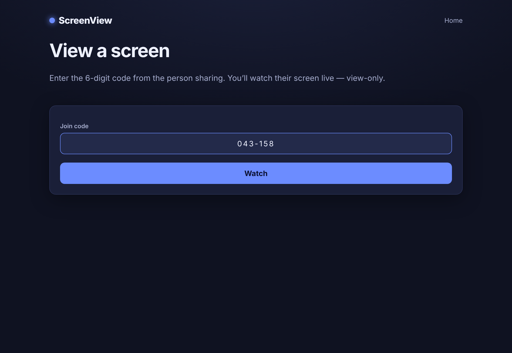
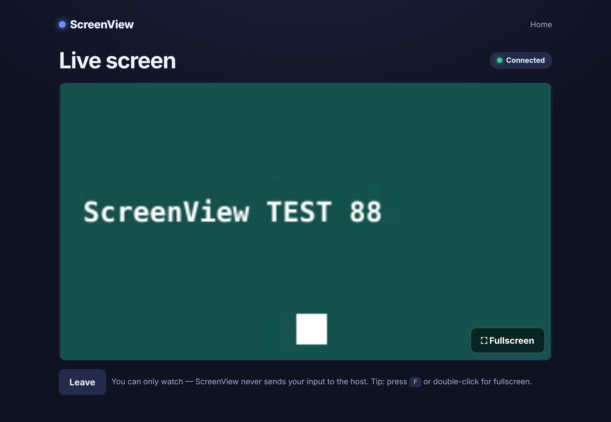
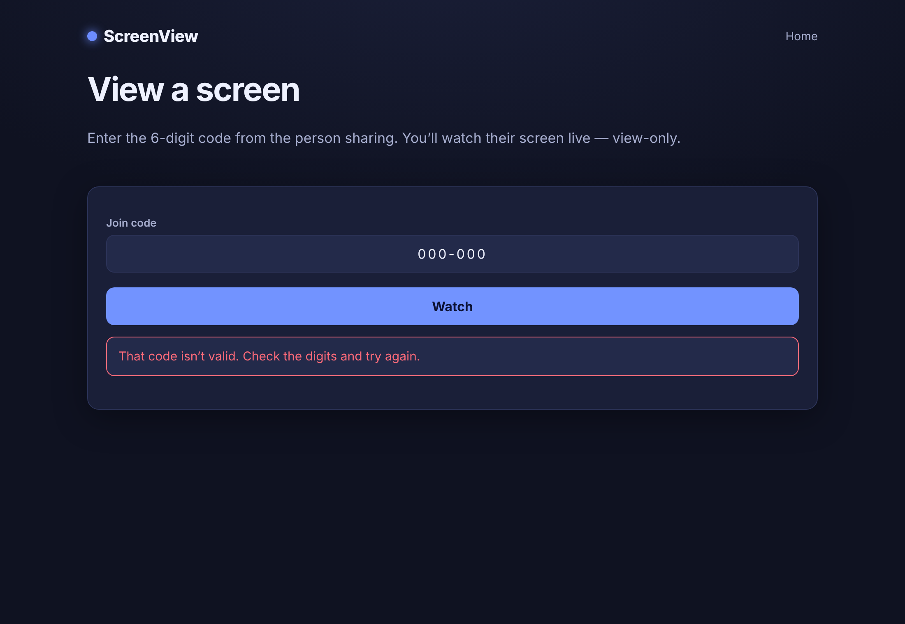
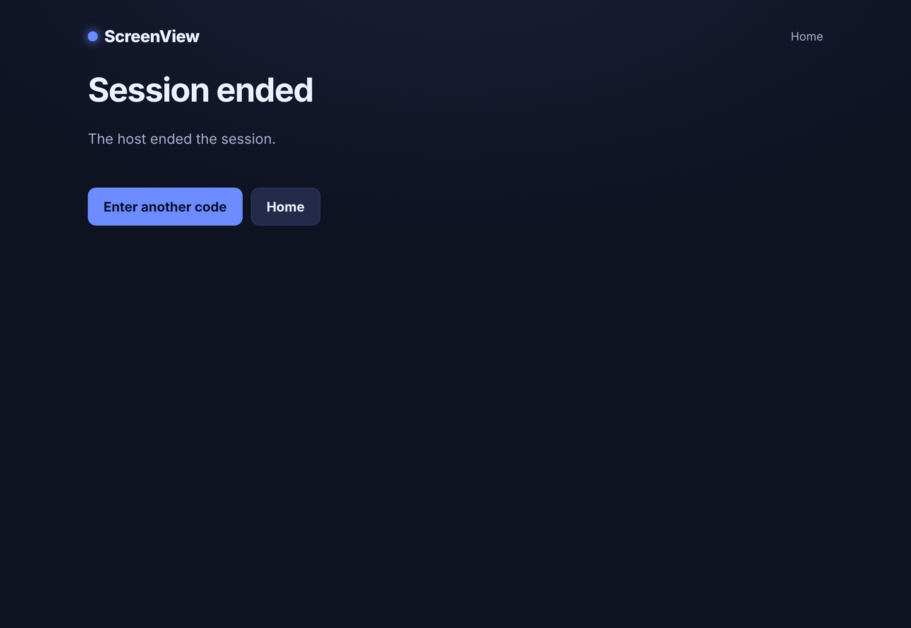
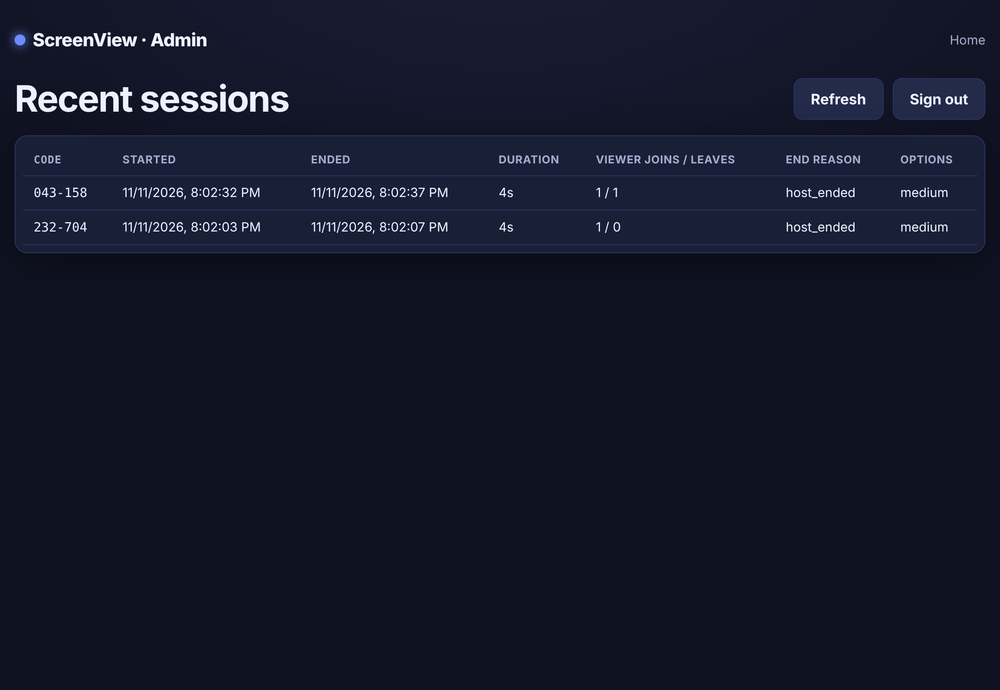

# User guide

ScreenView lets one person show their screen to another person, live, in the
browser. The person watching can only watch — they cannot click, type or
control anything on your computer.

You need: Chrome, Edge or Firefox on a laptop or desktop. The simplest setup is
to run ScreenView on the host's laptop: the host opens `http://localhost:3000`,
and the viewer opens the host laptop's network address, for example
`http://192.168.1.20:3000`.

**Install it as an app (optional).** In Chrome or Edge, click **⬇ Install app**
at the top of the page (or the install icon in the address bar). ScreenView then
opens in its own window from your Start menu, Dock or desktop, like any other
app. You can skip this; it works the same in a normal browser tab.

---

## If you are sharing your screen (the host)

1. Open ScreenView and click **Start sharing**.
2. Pick a **quality**:
   - **Low** — for slow connections.
   - **Medium** — good for most uses (default).
   - **High** — sharpest text, needs a fast connection.
3. *(Optional)* type a **session password**. Your viewer will need it as well as
   the code.
4. Click **Start sharing**. Your browser asks what to share — pick
   **Entire screen**, a **Window**, or a **Tab**, then click **Share**.
   To let your viewer hear sound, tick **Share tab audio** (when sharing a tab)
   or **Share system audio** (when sharing a screen, on Windows/Chrome) in that
   same box before clicking **Share**. Sharing a plain window usually has no
   audio option, and macOS can't share system audio — if you need sound there,
   share a **Tab** instead.

   

5. You now see a **6-digit code** like `232-704`. Tell it to your viewer (or
   click **Copy code**). Or click **Copy link** and send the link in a chat
   message: it opens ScreenView on the viewer's computer with the code already
   filled in. The code works for 10 minutes if nobody uses it.
   A small notification appears whenever a viewer joins or leaves.

   

6. While sharing you can see:
   - **Viewers** — how many people are watching.
   - **Session time** — how long you've been sharing.
   - **Quality** — change it at any time without stopping.
   - A small preview of what you're sharing (only you see this page).

7. To stop, click **End session**. You can also click your browser's own
   **Stop sharing** button — ScreenView notices and ends the session for you.
   Either way the code stops working for good.

**About the "you are sharing" bar:** your browser shows its own notice while
you share. That's normal, and ScreenView can't turn it off — it's there so you
always know when your screen is being shared.

**If your Wi-Fi drops:** keep the tab open. ScreenView reconnects by itself, and
your viewer keeps watching without typing the code again. If you're gone for
more than a minute, the session closes.

---

## If you are watching (the viewer)

1. If the host sent you a link, open it and skip to step 3 — the code is
   already filled in. Otherwise open ScreenView and click **Enter a code**.
2. Type the 6 digits — the dash is added for you — and click **Watch**.

   

3. If the host set a password, a password box appears. Type it and click
   **Watch** again.
4. The screen appears. The badge in the top right says **Connected**.

   

5. If the host is sharing sound, a **🔊/🔇 Sound** button appears over the
   video. Sound may start off (browsers block surprise audio) — click it once
   to turn sound on, and again to mute. No button means the host isn't sharing
   audio.
6. Click **⛶ Fullscreen**, press **F**, or double-click the picture to fill
   your screen; press **Esc** (or **F** again) to leave fullscreen.
7. Click **Leave** when you're done.

### Messages you might see

| Message | What it means | What to do |
|---|---|---|
| That code isn't valid | No session has that code | Check the digits with the host |
| That code has expired | Nobody used it within 10 minutes | Ask the host to start again |
| This session needs a password | The host set a password | Ask the host for it |
| This session is full | Someone is already watching | Ask the host |
| Too many attempts | Several wrong codes in a minute | Wait a minute |
| Reconnecting… | The network hiccuped | Wait — it comes back by itself |
| Session ended | The host stopped sharing | Ask for a new code if needed |
| Host disconnected | The host lost connection for over a minute | Ask the host to share again |

---

## For the person running the server (admin)

Open `/admin` and enter the admin password (set with `ADMIN_PASSWORD` when the
server starts) to see recent sessions: code, start and end time, duration,
viewer joins/leaves and why each session ended.

